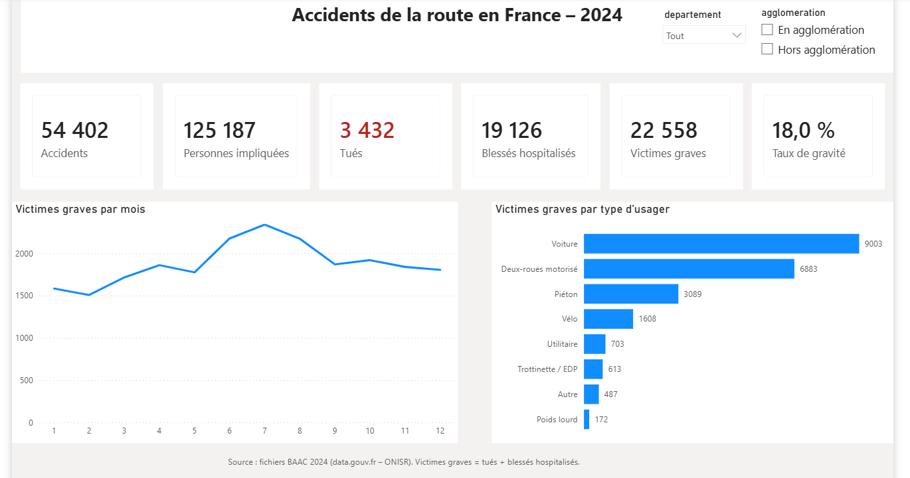
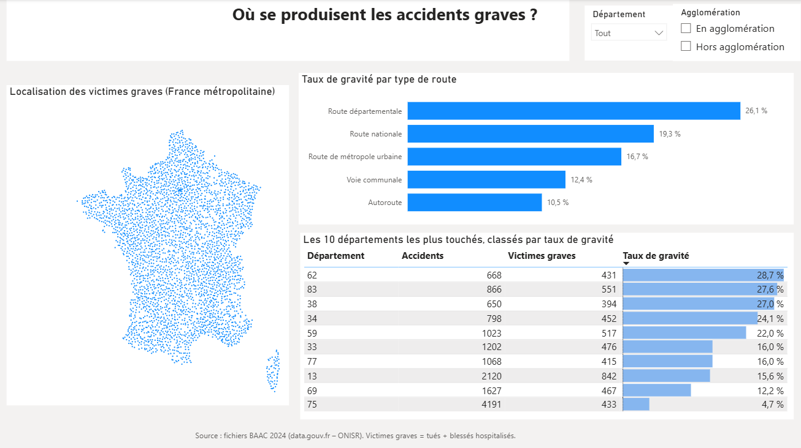
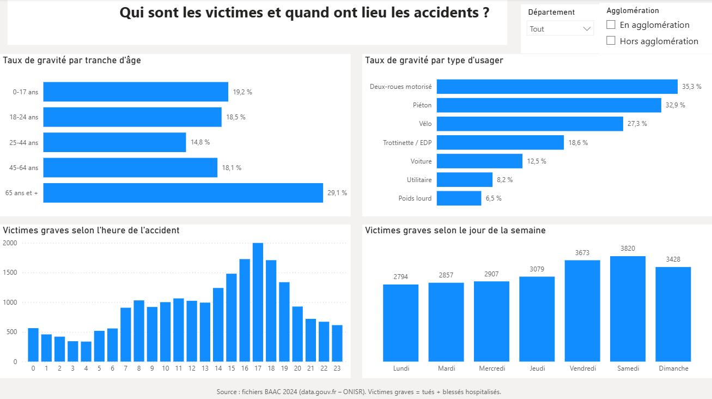

# 🚗 Accidents de la route en France (2024) : où et pourquoi faut-il agir ?

Analyse de bout en bout des **54 402 accidents corporels** survenus en France en 2024, à partir des données officielles du ministère de l'Intérieur (fichiers BAAC).
Objectif : identifier **où, quand, qui et dans quelles conditions** se produisent les accidents graves, pour orienter les actions de prévention.

**Outils :** Python (Pandas, Matplotlib) · SQL (DuckDB) · Power BI (DAX)

---

## 📊 Aperçu du tableau de bord

| Vue d'ensemble | Où ? | Qui et quand ? |
|---|---|---|
|  |  |  |

---

## 🎯 Chiffres clés 2024

| Indicateur | Valeur |
|---|---|
| Accidents corporels | 54 402 |
| Personnes impliquées | 125 187 |
| Tués | **3 432** (≈ 9 par jour) |
| Blessés hospitalisés | 19 126 |
| Victimes graves (tués + blessés hospitalisés) | 22 558 |
| Taux de gravité | 18,0 % des personnes impliquées |

✅ **Contrôle qualité :** le nombre de tués correspond exactement au bilan officiel de l'ONISR pour 2024 (3 432, métropole et outre-mer).

---

## 💡 Messages clés

1. **Le danger se concentre hors des villes.** Les routes départementales regroupent **54 % des victimes graves**, avec un taux de gravité de 26,1 %. Hors agglomération, un accident est presque deux fois plus souvent grave qu'en ville (25,6 % contre 13,1 %).
2. **La vitesse semble être le facteur commun.** Les situations les plus graves (routes de campagne, nuit sans éclairage, nuit profonde) correspondent à des routes où l'on roule vite. La ville éclairée et la pluie légère, où l'on roule moins vite, présentent les taux les plus bas.
3. **Les usagers vulnérables paient le plus lourd tribut.** Deux-roues motorisés, piétons, cyclistes et trottinettes représentent **30 % des personnes impliquées, mais 54 % des victimes graves**.
4. **Deux publics prioritaires.** Les 18-24 ans sont les plus exposés (environ 620 victimes graves par année d'âge), les 65 ans et plus les plus vulnérables (29,1 % de taux de gravité).
5. **Des moments à cibler.** 17 h concentre le plus de victimes graves (sortie du travail), la nuit les accidents les plus graves (26,7 % à 3 h), et le samedi est le jour le plus touché.

## ✅ Recommandations

- Concentrer les contrôles de vitesse et les aménagements (ronds-points, glissières, éclairage aux points dangereux) sur les **routes départementales hors agglomération**.
- Mener des campagnes de prévention ciblées sur les **18-24 ans**, en particulier sur les trajets de nuit et le week-end.
- Renforcer la protection des **usagers vulnérables** : équipements des motards, aménagements piétons et cyclables, sécurité des seniors.

## ⚠️ Limites

- Les données ne disent pas *pourquoi* un accident a lieu (vitesse réelle, alcool, fatigue) : ces causes restent des hypothèses.
- Faute de données sur le trafic, on ne peut pas calculer un risque « par kilomètre parcouru ».
- L'analyse porte sur une seule année (2024).

---

## 🛠️ Démarche

| Étape | Outil | Ce qui a été fait |
|---|---|---|
| 1. Chargement | Python | Lecture des 4 fichiers BAAC (caractéristiques, lieux, véhicules, usagers) |
| 2. Découverte | Python | Contrôle des types, des valeurs manquantes et de la colonne de liaison `Num_Acc` |
| 3. Nettoyage | Python | Coordonnées GPS converties, heure et date créées, colonnes vides supprimées, valeurs « non renseigné » (-1) traitées, 15 846 doublons de lieux (carrefours) résolus |
| 4. Fusion | Python | Assemblage en un tableau de 125 187 lignes (une par personne), avec contrôles de cohérence |
| 5. Analyse | Python | Indicateur « victime grave », taux de gravité par heure, âge, lieu, type de route, luminosité, météo |
| 6. Questions métier | SQL (DuckDB) | Départements prioritaires, usagers les plus vulnérables |
| 7. Export | Python | Fichier propre de 20 colonnes, prêt pour Power BI |
| 8. Restitution | Power BI | Tableau de bord de 3 pages, mesures DAX, filtres interactifs |

**Quelques difficultés rencontrées et résolues :**
- Un fichier source abîmé par Excel (identifiants tronqués en notation scientifique) : détecté par un contrôle `nunique()`, puis remplacé par le fichier d'origine.
- Des lignes en double dans la table des lieux (une ligne par route pour les accidents à un carrefour) : conservation de la route principale pour ne pas gonfler les chiffres.
- Un facteur caché : la nuit avec éclairage est *moins* grave que le plein jour, car l'éclairage correspond à la ville. C'est le lieu, et non la nuit seule, qui explique la gravité.

---

## 📁 Structure du dépôt

```
├── data/
│   └── README.md                  # Où télécharger les données
├── notebooks/
│   └── analyse_accidents.ipynb    # Nettoyage, fusion, analyse, SQL, export
├── sql/
│   ├── 01_departements_prioritaires.sql
│   └── 02_usagers_vulnerables.sql
├── powerbi/
│   └── dashboard_accidents_2024.pbix
├── images/                        # Captures du tableau de bord
├── requirements.txt
└── README.md
```

## ▶️ Reproduire l'analyse

1. Télécharger les données (voir `data/README.md`).
2. Créer l'environnement et installer les bibliothèques :
   ```bash
   python -m venv .venv
   .venv\Scripts\activate
   pip install -r requirements.txt
   ```
3. Ouvrir `notebooks/analyse_accidents.ipynb` et exécuter toutes les cellules.
4. Ouvrir `powerbi/dashboard_accidents_2024.pbix` avec Power BI Desktop.

---

## 📚 Source

Ministère de l'Intérieur / ONISR, *Bases de données annuelles des accidents corporels de la circulation routière*, année 2024, [data.gouv.fr](https://www.data.gouv.fr/datasets/bases-de-donnees-annuelles-des-accidents-corporels-de-la-circulation-routiere-annees-de-2005-a-2024).

## 👩‍💻 Auteure

**Fatima-Zahra FRINDOU** – Data Analyst · [GitHub](https://github.com/Fatima-Zahra37)
